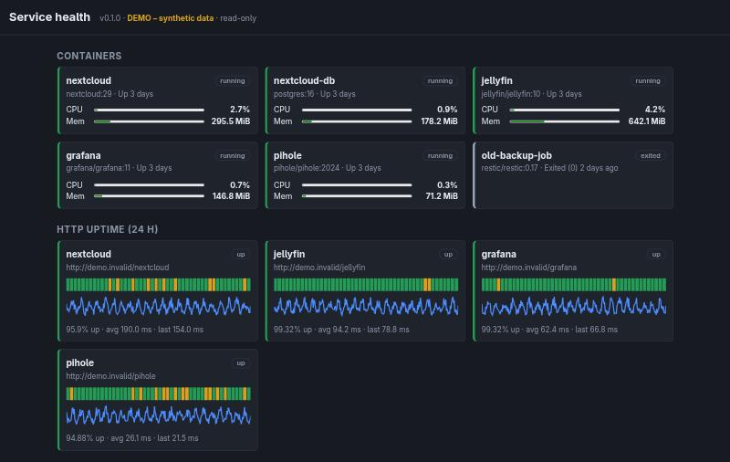

# Self-hosted service health dashboard

**Question.** A small, read-only dashboard for container status, resource use and HTTP uptime.

Status: **v0.1.0** (backend + HTMX frontend). Nothing here has been connected to a real homelab.



Mobile and error/empty states: [mobile](docs/screenshots/mobile-demo.jpg), [error + empty](docs/screenshots/error-empty-state.jpg).

## What exists
- FastAPI backend (`src/shd/`)
  - `GET /health` — liveness, version, mode
  - `GET /api/services` — containers with state, CPU %, memory
  - `GET /api/uptime?hours=24&limit=200` — per-target last result, uptime %, response-time stats, history
  - `GET /metrics` — Prometheus text format (`shd_target_up`, `shd_target_response_ms`, `shd_container_*`)
- Frontend: server-rendered Jinja2 page at `/` with htmx (vendored `static/htmx.min.js` 2.0.4, no CDN). Container cards (state, CPU, memory) poll `/ui/services` every 10 s; uptime cards (24 h status bar, response-time line, uptime %, avg/last ms) poll `/ui/uptime` every 15 s. Empty and error states are rendered.
- Checker: configurable HTTP targets, periodic async checks, results in SQLite (WAL; `(target, checked_at)` is the primary key, so duplicates are ignored).
- Docker access only through a **read-only docker-socket-proxy** over TCP. The `ContainerSource` interface only offers `list_containers()`; `unix://` hosts are refused by config validation.
- **Demo mode** (`--demo` / `SHD_DEMO=1`): synthetic containers and 24 h of synthetic uptime history; no Docker, no sockets, no outbound HTTP.
- `docker-compose.yml`: app + `tecnativa/docker-socket-proxy` (only `CONTAINERS=1`, `POST=0`), app bound to 127.0.0.1.

## Run (demo, nothing real is touched)
```bash
python -m venv .venv && .venv/bin/pip install -e '.[dev]'
.venv/bin/shd --demo --port 8000
curl localhost:8000/health
curl localhost:8000/api/services
curl 'localhost:8000/api/uptime?limit=3'
curl localhost:8000/metrics
```
A captured run is in [demo_verification.txt](demo_verification.txt).

## Configuration (env)
| Variable | Default | Meaning |
|---|---|---|
| `SHD_DEMO` | `0` | synthetic data only |
| `SHD_TARGETS` | empty | `name=url,name2=url2` or JSON list `[{"name","url","expected_status"}]` |
| `SHD_DOCKER_HOST` | unset | `tcp://docker-socket-proxy:2375` (must be tcp/http) |
| `SHD_DB` | `data/shd.sqlite` | SQLite path |
| `SHD_INTERVAL` / `SHD_TIMEOUT` | `30` / `5` | seconds |
| `SHD_RETENTION_DAYS` | `30` | non-negative integer days of check history to keep; `0` disables pruning |
| `SHD_API_TOKEN` | unset | optional bearer token for `/api/*` and `/metrics`; unset or empty leaves them open |

Checks older than the retention window are deleted once at startup and then by the
checker loop at most once per hour. Checks exactly at the cutoff are kept. Deleted
SQLite pages can be reused; pruning does not shrink the database file.

## API authentication
Authentication is **disabled by default**: when `SHD_API_TOKEN` is unset or empty,
the API and metrics remain open, as before. To enable it, set a strong secret in
the process environment (or `.env` for Compose) and restart the app:

```bash
export SHD_API_TOKEN="$(python -c 'import secrets; print(secrets.token_urlsafe(32))')"
.venv/bin/shd --demo --port 8000
# In another terminal with the same SHD_API_TOKEN exported:
curl -H "Authorization: Bearer $SHD_API_TOKEN" localhost:8000/api/services
curl -H "Authorization: Bearer $SHD_API_TOKEN" localhost:8000/metrics
```

When enabled, every request under `/api/*` and to `/metrics` requires the bearer
header, including in demo mode. Tokens are compared using a constant-time
comparison. Missing, malformed or incorrect credentials return HTTP 401 with
`WWW-Authenticate: Bearer`. Configure Prometheus's `authorization` bearer
credentials for scraping `/metrics`.

`/health`, `/`, static assets and `/ui/*` stay public. HTMX polls `/ui/services`
and `/ui/uptime`, whose handlers read the data directly on the server, so the UI
keeps working without credentials. No token is embedded in HTML, JavaScript or
cookies. **Trade-off:** this protects the JSON API and metrics only; dashboard
data remains visible through the public UI fragments. Use a reverse proxy with
TLS and authentication for the whole site if that data must be private. Use TLS
whenever transmitting the token beyond localhost or a trusted network.

## Tests
```bash
.venv/bin/pytest -q
```
Offline: a fake Docker client, `httpx.MockTransport`, and a fixture that fails on any real socket connect.

## Limitations
- CPU % uses the `docker stats` formula from a single sample; stats are best-effort and absent for stopped containers.
- API auth is optional and the dashboard stays public; keep it on localhost or a trusted network unless a reverse proxy protects the whole site.
- Compose was checked with podman-compose (`config` OK) and the `shd` service was built and run once in demo mode with `--no-deps` (no proxy, no socket); `/health` and `/ui/services` answered. The proxy service and a real socket were never started.

## Deploy guide (not performed by this repo)
1. On the Docker host: `git clone` the repo, `cp .env.example .env`, set `SHD_TARGETS` (e.g. `web=http://web:80,api=http://api:8080/health`) and keep `SHD_DEMO=0`.
2. The compose file starts `tecnativa/docker-socket-proxy` with only `CONTAINERS=1`; every other API group and all POST methods are off. It mounts `/var/run/docker.sock:ro` and sits on an `internal: true` network with no route out. The app reaches it via `SHD_DOCKER_HOST=tcp://docker-socket-proxy:2375`; never publish port 2375.
3. `docker compose up -d --build`. The app listens on `127.0.0.1:8000` only; SQLite lives in the `shd-data` volume.
4. To expose it, put a reverse proxy in front (Caddy/nginx/Traefik) with TLS and authentication to protect the public UI as well. Optionally set `SHD_API_TOKEN` in `.env` for API/metrics auth. Targets on other compose networks must be reachable from the `public` network (attach `shd` to them).
5. Check: `curl localhost:8000/health`, then `/api/services` should list real containers; Prometheus can scrape `/metrics`. Supply bearer credentials for both when `SHD_API_TOKEN` is set.

## v0.1.0
Backend (health, services, uptime, metrics, SQLite checker, socket-proxy client, demo mode) plus the HTMX frontend, compose file and Dockerfile. The `v0.1.0` GitHub release was published on 2026-10-17.

## Next steps
1. **Connecting to the real homelab is a separate decision by the owner and has not been done.** It means pointing `SHD_DOCKER_HOST` at a proxy on the actual Docker host and listing real `SHD_TARGETS`.

Part of a 30-project computational biology and scientific software portfolio.
